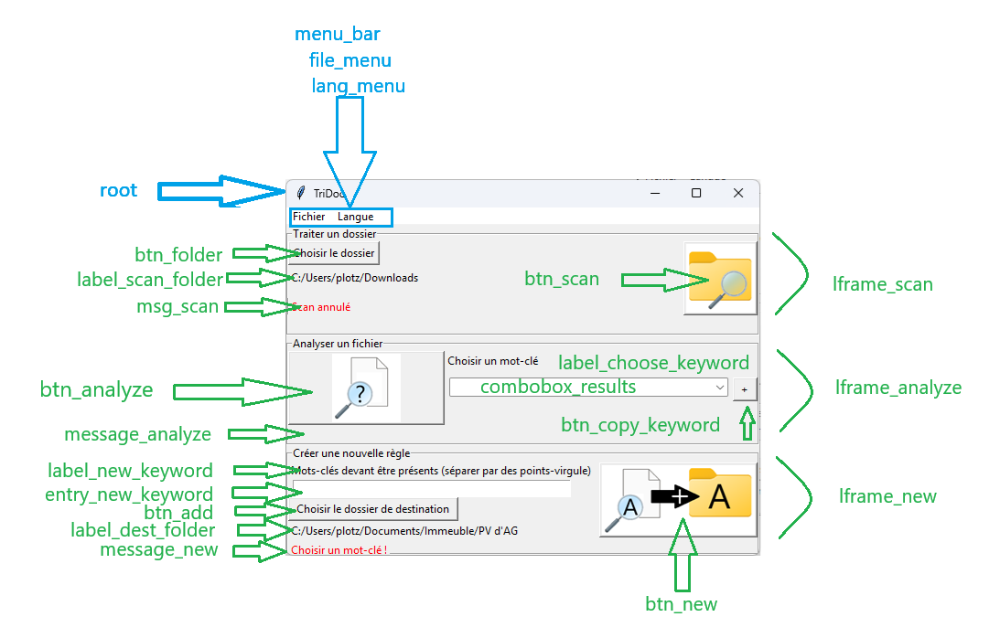

Programme permettant de :
- détecter des mots-clés dans un document
- créer des règles de tri
- scanner et tri un dossier
 

--- compiler

python.exe -m PyInstaller --clean --noconfirm --windowed --onedir --onefile --name TriDoc main.py

à côté du Tridoc.exe, placer :

- configuration.json {}

- traductions.csv

- icons/
